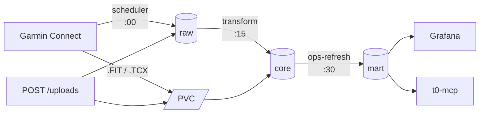

# t0

Self-hosted pipeline: Garmin Connect → PostgreSQL → Grafana (+ optional MCP server).
Built for triathlon training load tracking. Python 3.12, deployed with Helm.

## Data flow



1. `scheduler` polls Garmin Connect, archives raw payloads and `.FIT`/`.TCX` to a PVC.
2. `transform` parses raw → `core` (normalized).
3. `ops-refresh` refreshes the `mart.*` materialized views (TSS, PMC, power curve, wellness...).
4. Grafana reads `mart.*`. `t0-mcp` exposes them read-only to an LLM.

Runs at 10h, 15h, 22h. Schemas: `raw` (immutable), `core` (normalized), `mart` (views).

## Layout

| Path | Role |
| --- | --- |
| `src/t0/garmin` | Garmin Connect client (session reuse, backoff) |
| `src/t0/scheduler` | Poller, raw-first |
| `src/t0/fit`, `src/t0/tcx` | File parsers |
| `src/t0/transform` | raw → core |
| `src/t0/compute`, `src/t0/load` | NP, GAP, TSS, PMC, power curve |
| `src/t0/ops` | CLI: refresh, reconcile, backfill-status, health, seed-pmc |
| `src/t0/api` | Manual `.FIT` upload + RPE (FastAPI) |
| `src/t0/mcp` | Read-only MCP server over `mart.*` |
| `src/t0/db` | Forward-only migration runner |
| `migrations/` | Numbered SQL, never edit an applied one |
| `deploy/helm/t0` | Helm chart |
| `docs/RUNBOOK.md` | Operations |
| `docs/ARCHITECTURE.md` | Design |

## Cluster workloads

| Object | Default schedule | Role |
| --- | --- | --- |
| CronJob `scheduler` | `0 10,15,22 * * *` | Polls Garmin, backfills history |
| CronJob `transform` | `15 10,15,22 * * *` | raw → core |
| CronJob `ops-refresh` | `30 10,15,22 * * *` | Refreshes `mart.*` |
| CronJob `ops-backfill-status` | `0 6 * * *` | Backfill progress report (read-only) |
| CronJob `ops-reconcile` | `0 7 * * *` | Checks DB inventory vs PVC files (read-only) |
| CronJob `postgresql-backup` | `0 3 * * 0` | `pg_dump` to PVC |
| Job `migrate` | Helm hook | Applies migrations |
| Deployment `ingest` | — | Manual upload endpoint |
| Deployment `mcp` | — | MCP server (optional) |

Schedules and toggles: `deploy/helm/t0/values.yaml`.

## Develop

```bash
python -m venv .venv && source .venv/bin/activate   # Windows: .venv\Scripts\activate
pip install -e ".[dev]"

# CI checks, in order
ruff check .
ruff format --check .
mypy src tests
pytest
```

## Configure

- Env vars, read by `t0.settings.get_settings()`. List: `.env.example` (no real values, ever).
- No defaults for required fields: missing config fails at startup.
- Secrets are `SecretStr`; validation errors only name the variables, never the values.
- The Garmin credentials Secret is created on the cluster by hand. Never commit it.

**`GARMINTOKENS` must point to a persistent volume.** The image sets `/data/garmin-tokens`.
Without persistence, every restart does a full Garmin SSO login: that's how accounts get locked.

## Build

```bash
docker build -t t0-ingest .
```

Pushing a `vX.Y.Z` tag publishes the image to GHCR (`.github/workflows/publish-image.yml`).
`.dockerignore` keeps personal data and `.env` out of the image.

## Rules

Nothing in this repo or CI calls Garmin or deploys. The operator deploys.
Contributor rules: `AGENTS.md`.
