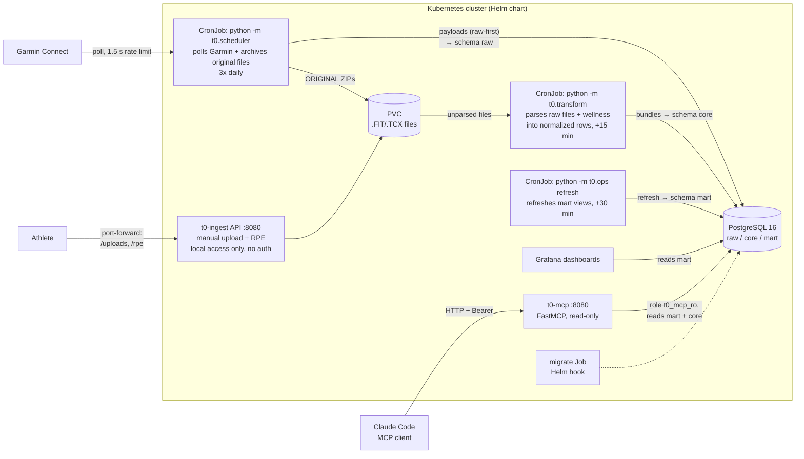
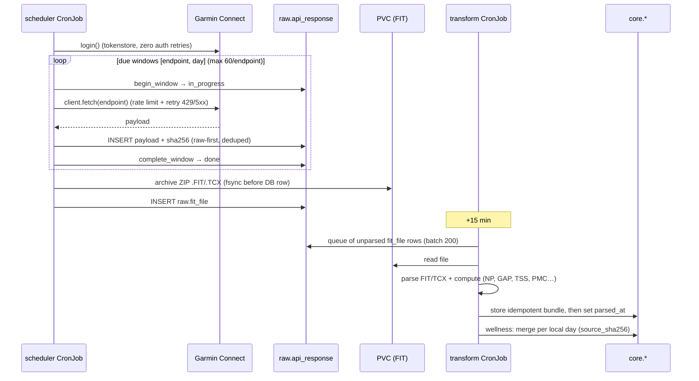
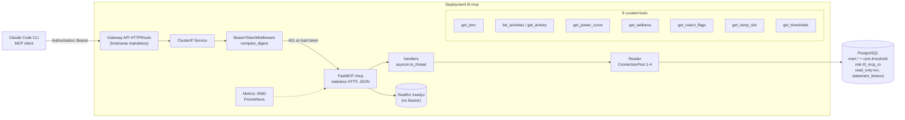
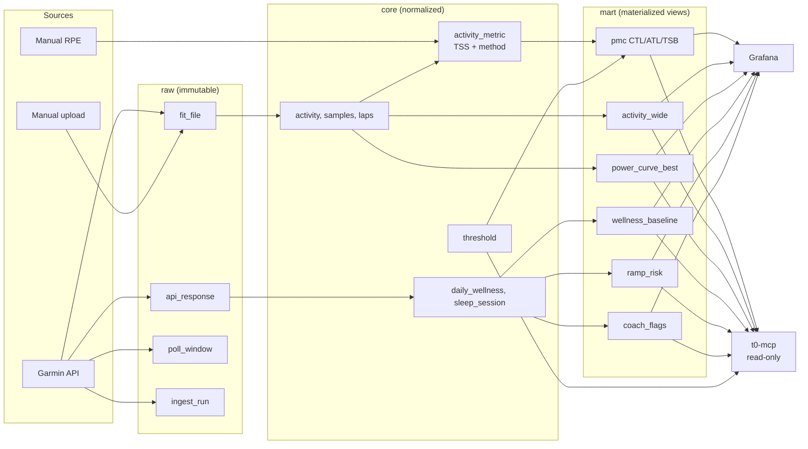

# ARCHITECTURE — t0 in diagrams

Mermaid diagrams of the running system: components, ingestion flow, MCP server,
data model. Operational procedures live in `RUNBOOK.md`; MCP details in `HANDOFF-MCP.md`.

## Contents

1. [Overview](#1-overview)
2. [Ingestion flow (raw-first ELT)](#2-ingestion-flow-raw-first-elt)
3. [MCP server](#3-mcp-server)
4. [Data model and consumers](#4-data-model-and-consumers)

---

## 1. Overview

Five components: `t0-ingest` (this repo), PostgreSQL, Grafana, the optional `t0-mcp`
server, and the Helm chart that deploys them.

Not shown for readability: the API also writes `raw.fit_file` rows, the MCP
server also reads `core.threshold` and `core.activity`, and the scheduler never
retries Garmin authentication.

Design rule: no agent or CI calls Garmin Connect and no agent or CI deploys to the
cluster — the athlete does.

## 2. Ingestion flow (raw-first ELT)

Every payload is written to `raw` before any processing. FIT files are fsynced to the
PVC before their DB row exists. Poll windows follow a state machine
`in_progress → done | failed`; a failed window never stops the run.

Manual path: `POST /uploads` archives the file and inserts `raw.fit_file` with
`garmin_activity_id = NULL`; the transform pass picks it up identically.
`POST /activities/{id}/rpe` writes a canonical `tss` row with `method_code = 'rpe'`.

## 3. MCP server

Read-only FastMCP server exposing exactly eight curated tools — no raw-SQL escape
hatch. Requires `T0_MCP_BEARER_TOKEN` and `T0_MCP_POSTGRES_DSN`; refuses to start
without them.

Safety layers: static Bearer token (`hmac.compare_digest`), read-only DB role,
`statement_timeout` baked into connections, hard `LIMIT` (default 500) injected into
every query, `{"rows": [...], "truncated": bool}` envelope.

## 4. Data model and consumers

Three schemas: `raw` (immutable API responses and files), `core` (normalized),
`mart` (materialized training-load views). Grafana and MCP read the same marts.

