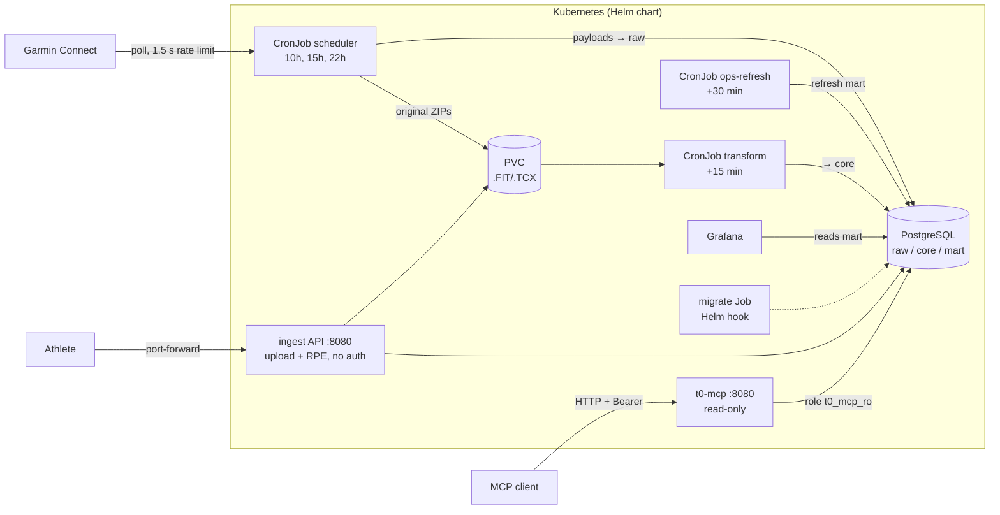
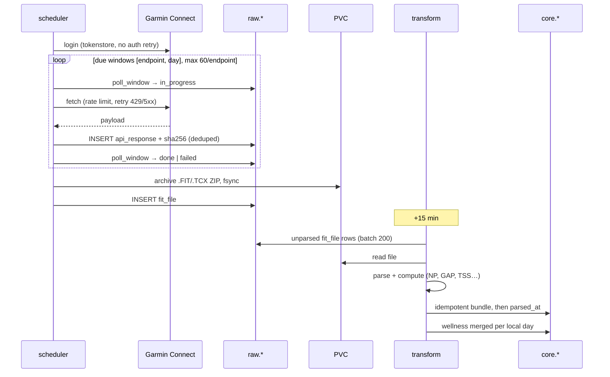
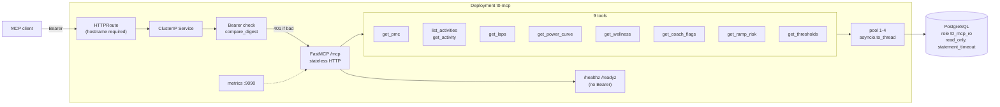
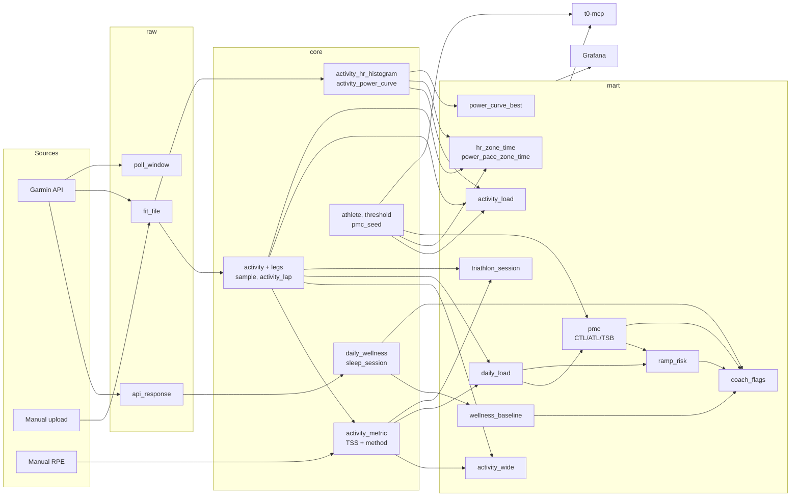

# ARCHITECTURE — t0 in diagrams

Components, ingestion flow, MCP server, data model.
Operations: `RUNBOOK.md`. MCP details: `HANDOFF-MCP.md`.

## Contents

1. [Overview](#1-overview)
2. [Ingestion flow (raw-first ELT)](#2-ingestion-flow-raw-first-elt)
3. [MCP server](#3-mcp-server)
4. [Data model and consumers](#4-data-model-and-consumers)

---

## 1. Overview

- Scheduler never retries Garmin authentication.
- No agent or CI calls Garmin or deploys. The operator does.

## 2. Ingestion flow (raw-first ELT)

- Every payload lands in `raw` before processing.
- Files are fsynced to the PVC before their DB row exists.
- A failed window never stops the run.

Manual paths:
- `POST /uploads`: archives the file, inserts `raw.fit_file` with `garmin_activity_id = NULL`.
  Transform handles it like any other.
- `POST /activities/{id}/rpe`: writes a `tss` metric with `method_code = 'rpe'`.

## 3. MCP server

Nine curated tools, no raw SQL. Won't start without `T0_MCP_BEARER_TOKEN` and
`T0_MCP_POSTGRES_DSN`.

Safety layers:
- Static Bearer token, constant-time compare.
- Read-only role, `statement_timeout` on every connection.
- Hard `LIMIT` (default 500) on every query.
- Envelope `{"rows": [...], "truncated": bool}`.

## 4. Data model and consumers

`raw` (immutable), `core` (normalized), `mart` (materialized views).
Grafana and MCP read the same marts.

Refresh order matters only along `daily_load → pmc → ramp_risk → coach_flags`
and `wellness_baseline → coach_flags`. `ops refresh` handles it.
