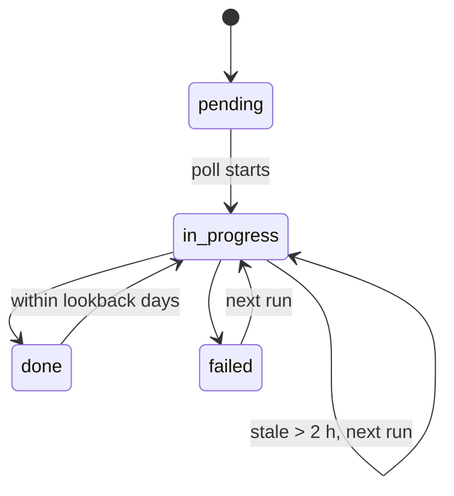
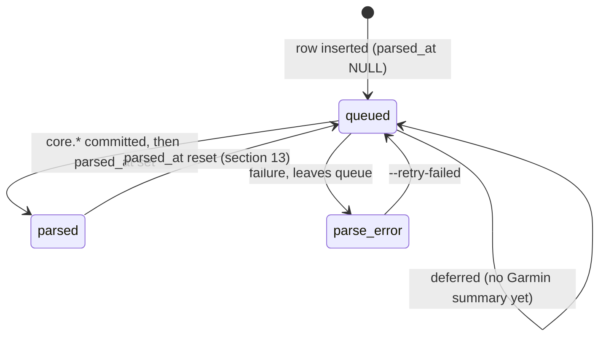

# RUNBOOK — Running t0

Operational procedures. Everything here exists; nothing is hypothetical.
Commands assume `T0_POSTGRES_DSN` is set (see section 7). `<release>` = Helm release name.

## Contents

1. [First startup](#1-first-startup)
2. [Recovering from a failure](#2-recovering-from-a-failure)
3. [A window stuck in `in_progress`](#3-a-window-stuck-in-in_progress)
4. [Restoring from a backup](#4-restoring-from-a-backup)
5. [Refreshing `mart` views manually](#5-refreshing-mart-views-manually)
6. [Garmin returns 401](#6-garmin-returns-401)
7. [Why not `--dsn`](#7-why-not---dsn)
8. [Daily polling (CronJob `scheduler`)](#8-daily-polling-cronjob-scheduler)
9. [Reconciling the PVC and `raw.fit_file`](#9-reconciling-the-pvc-and-rawfit_file)
10. [Daily transformation (CronJob `transform`)](#10-daily-transformation-cronjob-transform)
11. [Uploading a file manually](#11-uploading-a-file-manually)
12. [Seeding the PMC](#12-seeding-the-pmc)
13. [Multisport events (triathlon)](#13-multisport-events-triathlon)

## Quick reference

| Command | Does |
| --- | --- |
| `python -m t0.db migrate` / `status` | Apply migrations / show drift |
| `python -m t0.ops health` | Windows, failures, `mart` row counts |
| `python -m t0.ops backfill-status` | Backfill progress (read-only) |
| `python -m t0.ops refresh` | Refresh `mart.*` |
| `python -m t0.ops reconcile` | PVC vs `raw.fit_file` (read-only) |
| `python -m t0.ops seed-pmc` | Seed `mart.pmc` |
| `python -m t0.transform` | raw → core |
| `kubectl create job --from=cronjob/<release>-<name> <job>` | Run any CronJob now |

---

## 1. First startup

1. **Migrations.** Helm runs them as a hook Job (`migrate-job.yaml`). Manual run only
   locally or with `migrate.enabled=false`:

   ```
   python -m t0.db migrate
   python -m t0.db status   # "Drifts detected: " with no `!` lines
   ```

   SQL files come from `T0_MIGRATIONS_DIR` (image: `/app/migrations`), else `migrations/`.
   A failed hook Job is kept: `kubectl logs job/<release>-migrate`.

2. **`mart.*` views** are created populated but empty until activities land. Normal.

3. **Seed the athlete and thresholds. Mandatory, per database.** Personal data, so never a
   migration. Keep the filled copy outside the repo:

   ```
   cp deploy/seed/athlete.sql.example ~/t0-seed.sql
   $EDITOR ~/t0-seed.sql
   psql "$T0_POSTGRES_DSN" -f ~/t0-seed.sql
   ```

   Without it, `python -m t0.transform` exits 2 ("core.athlete contains 0 row(s)").
   It refuses to guess: a wrong athlete means wrong thresholds, wrong TSS, no symptom.

4. **Check state:** `python -m t0.ops health`. New database: no endpoints, no failed or
   stuck windows, `mart` views at 0 rows.

5. **First poll.** The `scheduler` CronJob backfills from `T0_HISTORY_START` on its own
   (section 8). To start now:

   ```
   kubectl create job --from=cronjob/<release>-scheduler first-poll
   ```

   To lighten the first run, set `scheduler.activityFiles: false` (JSON only), then back
   to `true` to fetch files later.

6. **Follow progress:** `python -m t0.ops backfill-status`. Report only, polls nothing.

## 2. Recovering from a failure

`raw.poll_window` lifecycle (one row per endpoint × day):



No manual action. Polling is replayable: `done` windows are skipped except the last
`refresh_lookback_days` (default 3). Restart the service; it resumes where it stopped.

Check what remains:

```
python -m t0.ops backfill-status --endpoint <endpoint> [--endpoint <endpoint> ...]
```

Endpoint names: `scheduler.endpoints` in `values.yaml`.

## 3. A window stuck in `in_progress`

Cause: process killed between `in_progress` and `done`/`failed`.

No DB intervention. `in_progress` windows older than 2 h
(`DEFAULT_STALE_IN_PROGRESS_AFTER`) are due again on the next poll, without duplicates.

- See them: `python -m t0.ops health`, section "Stuck in_progress windows".
- Still listed across several runs > 2 h apart: polling itself is down. Check
  `kubectl get pods` / `kubectl logs`.
- **Never** `UPDATE raw.poll_window SET status = 'failed'` by hand: it hides a dead poller.

## 4. Restoring from a backup

Backups: CronJob `postgresql-backup`, `pg_dump --format=custom`, in the PVC subpath
`fitArchive.subPaths.postgresBackups`, named `t0-<UTC-timestamp>.dump`.

1. Pick a dump (latest unless you need an older point).
2. Restore. **`--clean` wipes the target database.** Confirm the target first:

   ```
   pg_restore --clean --if-exists --no-owner --dbname="$T0_POSTGRES_DSN" t0-<timestamp>.dump
   ```

3. Verify, then refresh views (dumps don't carry materialized view data):

   ```
   python -m t0.db status
   python -m t0.ops health
   python -m t0.ops refresh
   ```

### Restore drill

An unrestored dump is not a backup. Run once after the first backup, and after every
PostgreSQL major upgrade. Restores into a throwaway database; never touches `t0`.
Needs free space equal to the data size: `kubectl exec <postgresql pod> -- df -h /var/lib/postgresql/data`.

1. Start a drill pod on the PostgreSQL node (PVC is `ReadWriteOnce`). Replace `t0` with
   your release name:

   ```
   kubectl apply -f - <<'YAML'
   apiVersion: v1
   kind: Pod
   metadata:
     name: t0-restore-drill
   spec:
     restartPolicy: Never
     automountServiceAccountToken: false
     securityContext:
       runAsNonRoot: true
       runAsUser: 999
       runAsGroup: 999
       # Must equal ingest.securityContext.fsGroup: kubelet re-chowns the volume
       # recursively, a different value breaks ingest writes.
       fsGroup: 10001
     affinity:
       podAffinity:
         requiredDuringSchedulingIgnoredDuringExecution:
           - labelSelector:
               matchLabels:
                 app.kubernetes.io/instance: t0
                 app.kubernetes.io/component: postgresql
             topologyKey: kubernetes.io/hostname
     containers:
       - name: drill
         image: postgres:18-alpine
         command: ["sleep", "3600"]
         env:
           - name: PGHOST
             value: t0-postgresql
           - name: PGUSER
             valueFrom:
               secretKeyRef: { name: t0-postgresql, key: username }
           - name: PGPASSWORD
             valueFrom:
               secretKeyRef: { name: t0-postgresql, key: password }
         volumeMounts:
           - name: backups
             mountPath: /backups
             subPath: postgres-backups
             readOnly: true
     volumes:
       - name: backups
         persistentVolumeClaim:
           claimName: t0-fit-archive
   YAML
   ```

2. Restore into a fresh database. `--exit-on-error` matters: without it a partial
   restore exits 0.

   ```
   kubectl exec -it t0-restore-drill -- sh
   dump=$(ls /backups/t0-*.dump | tail -1)   # fixed-width UTC names: last = newest
   createdb t0_restore_drill
   pg_restore --no-owner --exit-on-error --dbname=t0_restore_drill "$dump"
   ```

3. Check content. `migrations` must match the `.sql` count in `migrations/`; `latest`
   must match your last known activity. Empty `mart` views are expected.

   ```
   psql --dbname=t0_restore_drill -c "
     SELECT (SELECT count(*) FROM public.schema_migration)  AS migrations,
            (SELECT count(*) FROM core.activity)            AS activities,
            (SELECT max(start_time_local) FROM core.activity) AS latest,
            (SELECT count(*) FROM core.daily_wellness)      AS wellness_days;"
   ```

4. Clean up (otherwise a full data copy stays on the volume):

   ```
   dropdb t0_restore_drill
   exit
   ```
   ```
   kubectl delete pod t0-restore-drill
   ```

Write down the drill date. Not verified within a year = not verified.

## 5. Refreshing `mart` views manually

```
python -m t0.ops refresh
```

- Respects dependencies (`mart.daily_load` before `mart.pmc`).
- Views refresh independently; exit `1` = at least one failed.
- Never-populated views (after a restore) get a non-concurrent refresh automatically.
- Use after a restore or big catch-up. Otherwise `ops-refresh` CronJob handles it.

## 6. Garmin returns 401

The session in `GARMINTOKENS` is invalid: password changed, session expired, or account locked.

1. **Don't restart in a loop.** Each failed login brings the account closer to lockout.
2. Check `T0_GARMIN_USERNAME` / `T0_GARMIN_PASSWORD` (from the Garmin Secret keys
   `username`/`password`). The `T0_` prefix is required: unprefixed vars are silently
   ignored and the pod fails on a missing field, which doesn't look like a credentials issue.
3. Credentials fine but session expired: purge the tokens dir
   (`fitArchive.subPaths.garminTokens` on the PVC) to force one full login. Don't make
   this a habit: full logins are more visible to Garmin.
4. Still locked after logging in via a browser: Garmin account issue, not fixable here.

No automatic 401 detection. It shows up as `failed` windows in `python -m t0.ops health`,
with the error in `raw.poll_window.last_error`.

## 7. Why not `--dsn`

`python -m t0.ops --dsn` exists for occasional interactive use. Prefer `T0_POSTGRES_DSN`:
a DSN argument exposes the password in `ps`, `/proc/<pid>/cmdline` and `kubectl describe pod`.
The env var is only in `/proc/<pid>/environ`, same as Garmin credentials.

---

## 8. Daily polling (CronJob `scheduler`)

The only piece that calls Garmin. Template: `scheduler-cronjob.yaml`.

| Key | Default | Effect |
| --- | --- | --- |
| `scheduler.enabled` | `true` | `false` disables polling |
| `scheduler.schedule` | `"0 10,15,22 * * *"` | 10:00 gets the night (sleep, HRV); 15:00 and 22:00 get the day's activities |
| `scheduler.maxWindowsPerEndpoint` | `60` | Windows per endpoint per run. Bounds run time and API load |
| `scheduler.activityFiles` | `true` | `false` = JSON only, no `.FIT`/`.TCX` download |
| `scheduler.endpoints` | the 10 of `DEFAULT_ENDPOINTS` | Must match the code; `tests/test_config_coherence.py` checks |

A run: compute due windows (every day not `done` since `T0_HISTORY_START`, plus the last
`T0_REFRESH_LOOKBACK_DAYS`, plus today), poll each endpoint, archive the listed activity files.

Backfill has no separate command: this CronJob consumes it run after run.

**Do not relax these:**
- `concurrencyPolicy: Forbid`: parallel runs = parallel Garmin logins = lockout.
- `backoffLimit: 0`: failed windows are retried next run; instant retries speed up lockout.

---

## 9. Reconciling the PVC and `raw.fit_file`

Rule (`migrations/002_raw.sql`): **file written and fsynced on the PVC before its row is
inserted.** CronJob `ops-reconcile` (daily 07:00) checks it. Read-only: PVC mounted
`readOnly`, deletes nothing.

| Anomaly | Severity | Meaning |
|---|---|---|
| Orphan file (on PVC, no row) | benign | Archive ok, INSERT failed. Unused file |
| Orphan row (row, no file) | **grave** | Source lost; rebuilding `core` will fail or skip it |
| Size or sha256 mismatch | **grave** | Truncated or overwritten |

The Job fails only on grave anomalies.

Run now and read:

```bash
kubectl create job -n <namespace> --from=cronjob/<release>-ops-reconcile manual-scan
kubectl logs -n <namespace> job/manual-scan
```

Default compares sizes. For silent corruption, set `opsReconcile.deep=true` or run from a
pod mounting the PVC:

```bash
python -m t0.ops reconcile --archive-root /data/fit-archive --deep
```

### Handling anomalies

- **Orphan files:** not urgent. Re-check no row references one before deleting. A sudden
  pile-up is a symptom to investigate. Deployments predating the ZIP hash fix in
  `t0.scheduler.activity_files` have many; they're harmless.
- **Orphan rows:** if the activity still exists at Garmin, delete the row and let polling
  re-download it. A manual upload's file was the only copy.
- **Every row orphaned at once:** almost always the PVC mounted at a different path.
  Compare `--archive-root`, `ingest.config.fitArchivePath` and the mount `subPath`.

## 10. Daily transformation (CronJob `transform`)

```
python -m t0.transform [--limit N] [--athlete-id N] [--retry-failed]
```

Reads `raw.fit_file` rows with `parsed_at IS NULL`, writes `core.*`. Runs between poll and
refresh (`transform.schedule`).



**Order poll → transform → refresh is mandatory.** Refresh before transform succeeds
silently with stale data. `tests/test_config_coherence.py` enforces it.

### Exit codes

| Code | Meaning |
| --- | --- |
| `0` | OK, **including deferred files** (Garmin summary not ingested yet; retried next run) |
| `1` | At least one file failed; see `raw.fit_file.parse_error` |
| `2` | Didn't start: no DSN, or `core.athlete` empty/ambiguous (section 1, step 3) |

### A failed file

```
SELECT fit_file_id, garmin_activity_id, storage_path, parse_error
FROM raw.fit_file WHERE parse_error IS NOT NULL ORDER BY downloaded_at DESC;
```

Files with `parse_error` leave the queue. Fix the cause first (sport mapping, decoder), then:

```
python -m t0.transform --retry-failed
```

Success clears `parse_error`.

### Backlog

Each activity commits on its own: an interrupted run loses one file at most. Batch size:
`transform.batchLimit`. To speed up:

```
kubectl create job --from=cronjob/<release>-transform transform-catchup
```

`concurrencyPolicy: Forbid` keeps it from overlapping the scheduled run.

`core.*` is committed **before** `parsed_at` is set. A crash in between requeues the file;
writes are idempotent, so no duplicates.

## 11. Uploading a file manually

```bash
curl -F "file=@/path/to/activity.fit" http://localhost:8000/uploads
```

- `POST /uploads` (`t0.api.upload`): **local only**, no Ingress, TLS or auth.
- For activities polling can't get (other tools, deleted on Garmin).
- FIT, TCX, or a ZIP of either. Detected by content, not extension.
- Archived like polling (fsync before INSERT), with `garmin_activity_id = NULL`. That
  NULL is the only upload marker (`migrations/012_raw_fit_file_manual_upload.sql`).

| Code | Meaning |
|---|---|
| `201` | Archived and parsed. Body has `fit_file_id` |
| `409` | Same `sha256` already tied to another origin. File archived, no rows changed |
| `413` | Body too large |
| `422` | Unrecognized content (not FIT/TCX, bad ZIP) or parsing failed. Body says which; archive kept |

### In `core.*`

Handled by `t0.transform.manual` (migrations 012, 014):

- **Context** (sport, duration) comes from the file: FIT `session`, or TCX `Activity@Sport`.
  Timezone comes from `core.athlete.home_timezone`.
- **IDs** come from `core.manual_activity_id_seq`, starting at 1e15: above any Garmin id,
  below 2^53 so JSON doesn't round it. `core.activity.source` records provenance; CHECK
  `activity_synthetic_id_range` keeps both consistent. Unique index `activity_manual_file_uq`
  on `fit_file_id` prevents duplicates.

**Sport is never guessed.** Unknown sport → `UnknownManualSportError` → `parse_error`.

- TCX only knows `Running` | `Biking` | `Other`. Indoor rides land as `cycling`, not
  `virtual_cycling`. `Other` is refused.
- To add a FIT sport: `SPORT_CODE_BY_FIT_SPORT` (`t0.transform.manual`), `core.sport`, and
  `core.sport_fit_map` (`migrations/015_core_sport_fit_map.sql`). A test checks all three agree.

---

## 12. Seeding the PMC

**`mart.pmc` stays empty until `core.pmc_seed` has a row.** Every fitness/fatigue panel
depends on it.

```bash
python -m t0.ops seed-pmc --athlete-id 1 --dry-run   # inspect
python -m t0.ops seed-pmc --athlete-id 1             # persist
```

| Flag | Meaning |
|---|---|
| `--athlete-id` | Required. `core.athlete.athlete_id` |
| `--seed-date` | Start of the 42-day window. Default: first day with known load in `mart.daily_load` |
| `--dry-run` | Print, don't write |

Default `--seed-date` skips days without computable TSS (no threshold in effect): averaging
zeros would make the athlete look detrained on day one.

**Re-seeding** inserts a new row; `mart.pmc` uses the latest. Nothing to delete.
`tools/validate_schema.sql` section 7 checks `pmc_rows` = days since the active seed.

`ctl_reliable = false` for the first 180 days after the seed. Expected, not a bug.

---

## 13. Multisport events (triathlon)

Garmin only lists the parent (`isParent: true`). Legs exist only as `session` messages in
the single FIT file (swim, T1, bike, T2, run).

Since parser `t0-transform/2` (migration 023), transform splits it: one `core.activity` per
leg (`source='leg'`, `parent_activity_id` set, own samples and TSS); parent kept as is.
Load views count legs and exclude parents. Migration 025 adds `mart.triathlon_session`,
used by dashboard `t0-session-tri`.

### Requeue files parsed by version 1

```sql
SELECT fit_file_id, garmin_activity_id FROM raw.fit_file f
JOIN core.activity a ON a.fit_file_id = f.fit_file_id
WHERE a.is_parent AND f.parser_version < 't0-transform/2';

UPDATE raw.fit_file SET parsed_at = NULL, parser_version = NULL
WHERE fit_file_id IN (/* ids above */);
```

Next transform rebuilds the parent and adds legs. Then refresh (section 5).

### After migration 024 (synthetic id range shrink)

024 deletes legs with old ids (9.2e18) so they come back under 2^53. Re-transform alone
would reuse the old ids. Requeue parents:

```sql
UPDATE raw.fit_file SET parsed_at = NULL
WHERE fit_file_id IN (
  SELECT DISTINCT fit_file_id FROM core.activity WHERE is_parent
);
```

Then `python -m t0.transform` and refresh (section 5). Legs are missing until then.

### Failure modes

- Unknown `(sport, sub_sport)` in any session fails the whole file: a triathlon missing a
  leg would skew load silently. Fix `SPORT_CODE_BY_FIT_SPORT`, then `--retry-failed`.
- If Garmin ever publishes legs, the split is refused for that parent: real legs win.
